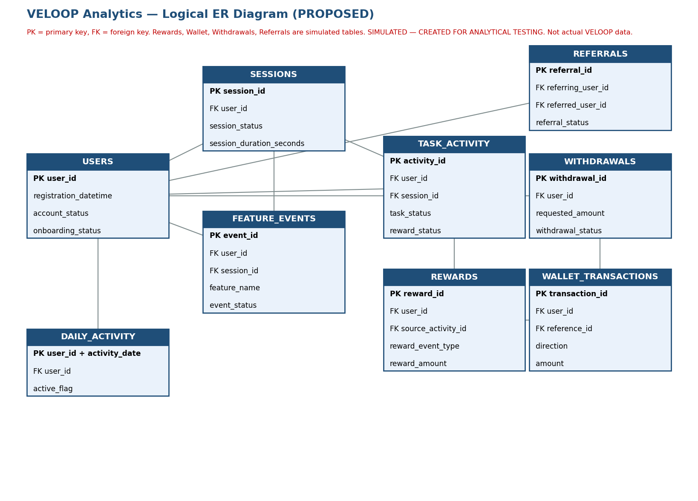

# Logical Data Model (WP-H)

## Entities and primary keys
| Entity | Primary key | Notes |
|---|---|---|
| Users | user_id | One row per user |
| Sessions | session_id | Existence To Be Verified (A002) |
| Feature_Events | event_id | Dedupe key |
| Daily_Activity | user_id + activity_date | Composite key |
| Task_Activity | activity_id | One row per task attempt |
| Rewards | reward_id | Proposed; table not supplied |
| Wallet_Transactions | transaction_id | Proposed; table not supplied |
| Withdrawals | withdrawal_id | Proposed; table not supplied |
| Referrals | referral_id | Proposed; table not supplied |
| Milestones | user_id + milestone_type + milestone_datetime | Supplied in behavior file |

## Foreign keys and relationships
- Users (1) → Sessions (many) via user_id
- Users (1) → Feature_Events (many) via user_id
- Sessions (1) → Feature_Events (many) via session_id
- Users (1) → Task_Activity (many) via user_id
- Sessions (1) → Task_Activity (many) via session_id
- Task_Activity (1) → Rewards (0..1) via source_event_id (a reward is created only for completed tasks)
- Rewards (1) → Wallet_Transactions (many) via reference_id
- Withdrawals (1) → Wallet_Transactions (0..many) via reference_id (debits)
- Users (1) → Withdrawals (many) via user_id
- Users (1) → Referrals (many) as referring_user_id and as referred_user_id (two relationships, one user can be both)
- Users (1) → Daily_Activity (many) via user_id
- Users (1) → Milestones (many) via user_id

Many-to-many: none needed at the model level. A user can have many referrals, and a referral has exactly one referring user and at most one referred user.

Event vs transaction: Feature_Events and Milestones are event logs (append-only). Wallet_Transactions is a ledger (reversals are new rows referencing the original, never edits).

## ER diagram (Mermaid)

Legend: `||--o{` = one to many. `||--o|` = one to zero or one.

## Known problems that affect this model
- Users and Task_Activity use the same user_id but the two supplied files disagree on who each user is (DQ-006). Do not use cross-file joins.
- Sessions have no failed or abandoned rows (DQ-011), so session-level failure cannot be modelled from supplied data.
