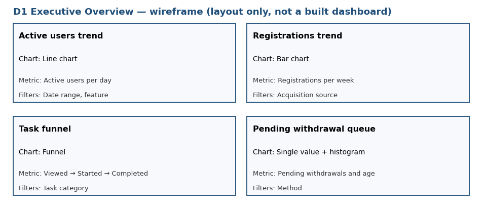
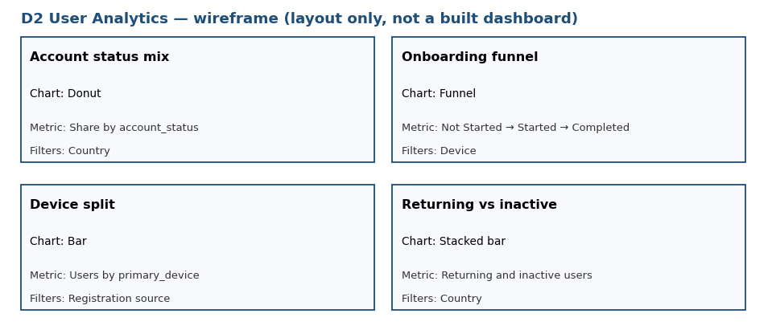
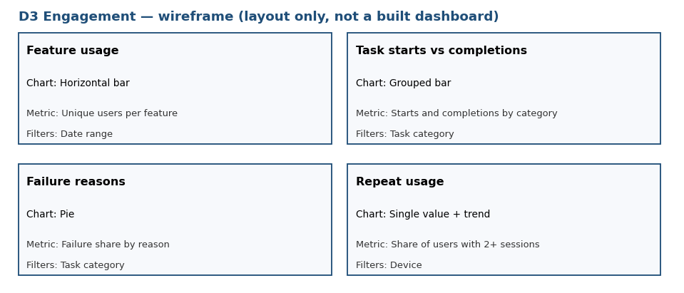
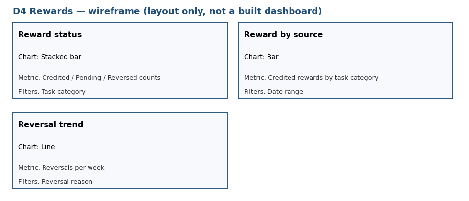
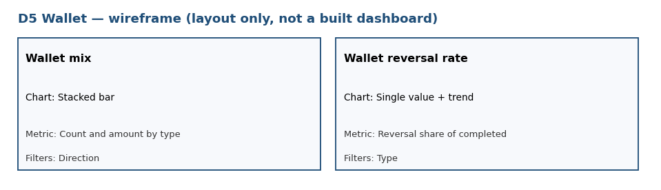
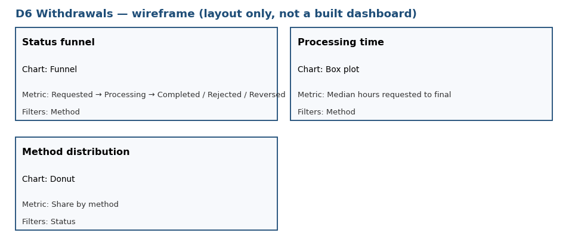
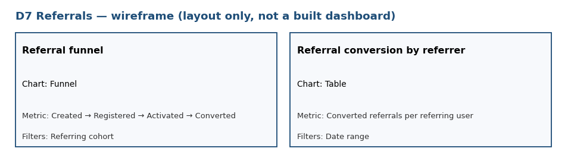

# Dashboard Blueprint (WP-M)

Specification only. No production dashboard is built. Each visual lists metric, calculation, source, visual, filters, dimensions, date range, refresh, business question, decision supported.

## Dashboard 1 — Executive Overview
| Visual | Metric | Source | Refresh | Business question |
|---|---|---|---|---|
| KPI tiles | Registrations, active users, task completion rate | KPI-01, 02, 11 | Daily | Is activity growing? |
| Trend line | Active users by day | Feature_Events | Daily | Is engagement stable? |
| Funnel | Task viewed → started → completed | Task_Activity | Daily | Where do users drop? |
| Status tile | Withdrawal pending queue | Withdrawals (proposed) | Daily | Is payout backlog growing? |

## Dashboard 2 — User Analytics
Registrations by source, active and returning users, device split, country split, lifecycle status mix. Filters: acquisition_source, primary_device, country. Refresh: daily. Note: state-level views require consent (see 12_Pipeline_Governance).

## Dashboard 3 — Engagement
Feature usage bar (unique users per feature), task starts vs completions, repeat usage, sessions per user trend. Filters: feature_name, task_category.

## Dashboard 4 — Rewards
Credited vs pending vs reversed counts, reward activity by task_category, reversal trend. Depends on Rewards table (not supplied).

## Dashboard 5 — Wallet
Transactions by type, credit volume, redemption volume, reversal rate. Depends on Wallet table (not supplied).

## Dashboard 6 — Withdrawals
Requests by status, processing time distribution (median), method mix, pending queue age. Depends on Withdrawals table (not supplied).

## Dashboard 7 — Referrals
Referrals created, registrations, activations, conversion funnel. Depends on Referrals table (not supplied).

## Rules for every dashboard
- Show data source and last refresh time on screen.
- Simulated data must be labelled "SIMULATED" on every page where it appears.
- No target lines unless a target is approved by the business.

## Wireframes

### D1 Executive Overview

### D2 User Analytics

### D3 Engagement

### D4 Rewards

### D5 Wallet

### D6 Withdrawals

### D7 Referrals

