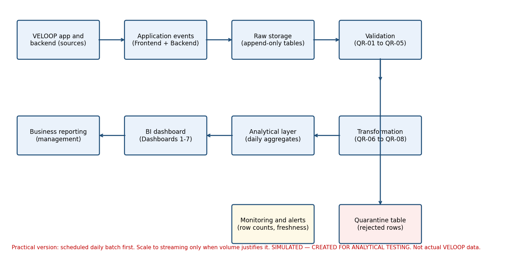

# Data Pipeline and Governance (WP-O, WP-P)

## Pipeline (practical version for a developing product)
VELOOP app/backend → application events → raw storage (append-only tables) → validation (QR-01 to QR-10) → transformation (joins, state logic, dedupe) → analytical tables (daily aggregates) → BI dashboards → business reporting.

- Start simple: scheduled daily batch job, raw tables in the production database replica or a warehouse, dashboards on aggregates.
- Scale only when volume justifies streaming or a separate warehouse.
- Monitoring: row counts raw vs analytical daily; alert if quality checks fail; alert if the pipeline has not run.
- Failure handling: quarantine table for rejected rows; rerun is idempotent because of event_id and transaction_id.
- Ownership: Engineering (event emission, raw layer), Data Analyst (transformation rules, KPIs), Product (definitions).

## Access model
| Role | Access |
|---|---|
| Engineering | Event implementation, raw layer |
| Data Analyst | Approved analytical datasets |
| Product / Operations | Aggregated reporting |
| Content Team | Aggregated content performance |
| Intern | Only approved or sanitised datasets |

## Must not be exposed
Passwords, authentication secrets, API keys, payment credentials, private security controls, bank or card numbers, government ID numbers, and personal contact details beyond what reporting needs.

## Consent and sensitive fields
State, age band and marketing opt-in depend on consent_status. Sensitive attributes (race, religion, health, etc.) are not collected for analytics.

## Simulated data rule
Simulated tables must be labelled, stored separately from production, and removed from reporting when production data exists (Integrity Rule 12).

## Architecture diagram

